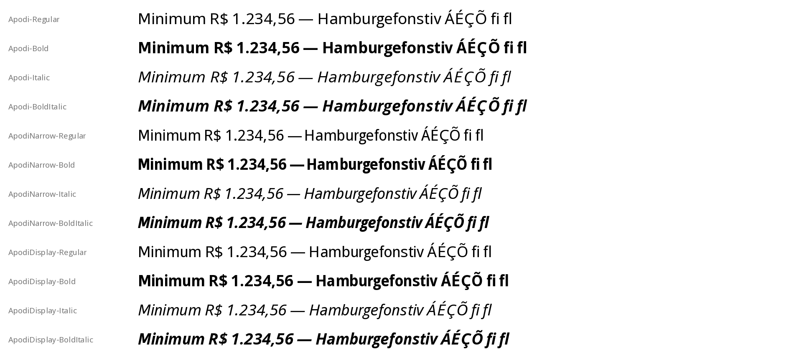

# Apodi

**An open, metric-compatible alternative to Aptos.**

Apodi is a sans-serif family built from [Open Sans](https://github.com/googlefonts/opensans)
(SIL Open Font License 1.1), refitted so that text set in it takes the same horizontal space as
text set in Aptos, Microsoft Office's default typeface: every covered character has the same
advance width, the kerning pairs have the same values, and the vertical metrics are the same.
A document laid out with Aptos keeps its line breaks and page breaks when Apodi stands in for it.

"Aptos" is named here only to describe compatibility; Apodi is not affiliated with or endorsed
by Microsoft, and contains no Microsoft font data other than the metric numbers listed below.



## Styles

| Family | Styles | Compatible with | Use |
|---|---|---|---|
| Apodi | Regular, Bold, Italic, Bold Italic | Aptos | Word/PowerPoint body text |
| Apodi Narrow | Regular, Bold, Italic, Bold Italic | Aptos Narrow | Excel's default font |
| Apodi Display | Regular, Bold, Italic, Bold Italic | Aptos Display | Word headings |

Files: `fonts/ttf/*.ttf` (desktop, LibreOffice) and `fonts/woff2/*.woff2` (web). Unhinted
TrueType, 2048 units per em, about 1,380 glyphs per style (Latin, Greek, Cyrillic, Hebrew from
Open Sans; arrows, shapes, box drawing, circled digits, a few math signs, other scripts'
currency signs and Coptic letters from Noto).

Coverage: all 1,086 characters in Aptos (1,085 in the italics, as in Aptos), each at Aptos's
advance width.

## Using it as a substitute (fontconfig / LibreOffice)

```xml
<!-- ~/.config/fontconfig/fonts.conf -->
<alias binding="same"><family>Aptos</family><accept><family>Apodi</family></accept></alias>
<alias binding="same"><family>Aptos Narrow</family><accept><family>Apodi Narrow</family></accept></alias>
<alias binding="same"><family>Aptos Display</family><accept><family>Apodi Display</family></accept></alias>
```

In a browser: `font-family: Aptos, Apodi, sans-serif;` with `@font-face` rules pointing to the
WOFF2 files.

## Building

```sh
python3 -m venv .venv && .venv/bin/pip install -r requirements.txt

./build.sh fonts                    # sources/*.ufo -> fonts/ttf + fonts/woff2
APTOS_DIR=/path/to/aptos ./build.sh check   # metric + line-break checks against the reference
APTOS_DIR=/path/to/aptos ./build.sh images  # side-by-side PNGs (docs/comparison, kept local)
APTOS_DIR=/path/to/aptos ./build.sh fit     # regenerate sources/ from Open Sans + reference metrics
```

* `fonts` needs nothing but this repository. The binaries are reproducible (same bytes for
  the same sources).
* `check`, `images` and `fit` read the Aptos `.ttf` files from a folder you point to with
  `APTOS_DIR`. Nothing from that folder is copied into this repository. `fit` writes only
  numbers to `build/metrics/`, which git ignores.
* `fit` also downloads the Open Sans sources and the Noto fonts at pinned commits
  (`scripts/fetch_opensans.sh`, `scripts/fetch_noto.sh`, checked by SHA-256, kept out of git)
  and **overwrites `sources/`**. Run it only to change the fitting itself, not after editing
  glyphs.

To edit letterforms, see [EDITING.md](EDITING.md). For how the fonts were made, the
validation results and the known differences, see [REPORT.md](REPORT.md).

## Legal notes

* **Outlines**: every contour, component and anchor comes from Open Sans's own sources:
  googlefonts/opensans, commit `bd7e37632246368c60fdcbd374dbf9bad11969b6` (v3.003,
  2023-11-16), `sources/*.ufo` + `OpenSans-Roman/Italic.designspace`, SIL OFL 1.1. Open Sans
  declares no Reserved Font Name. The family is still renamed, as the OFL asks of modified
  versions. The exception is the 84 characters Open Sans doesn't have (arrows, shapes, box
  drawing, circled digits, ∙ ∟ ∩ ∶ ≡ ⌂ ⌐ ⌠ ⌡ ⟨ ⟩, ☐ ☑ ✓ ❦ ⮽ ⮾, ֏ ؋ ৲ ৳ ૱ ௹ ฿ ៛ ⃀ ﷼ and
  Coptic Ϣ–ϯ): their outlines come from Noto fonts in google/fonts, commit
  `47d54ca1ebb14fd864695f1d39dc734f39017c33` (2026-10-16): Noto Sans 2.015, Noto Sans Mono
  2.014, Noto Sans Symbols 2.003, Noto Sans Symbols 2 2.008, Noto Sans Math 3.000, Noto Sans
  Coptic 2.004, Noto Sans Armenian 2.008, Arabic 2.012, Bengali 3.011, Gujarati 2.106, Tamil
  2.004, Thai 2.002 and Khmer 2.004. All are SIL OFL 1.1 (checked in each font's license
  record and google/fonts' OFL.txt) and declare no Reserved Font Name.
* **From Aptos, numbers only**: advance width per Unicode codepoint, advance per ligature
  character sequence (`fi`, `fl`, `ff`), kerning value per codepoint pair, unitsPerEm,
  ascender, descender and line gap (hhea, typo, win), cap height, weight class and italic
  angle, and the bounding boxes of the six box-drawing characters and the two integral halves
  (so that they join across lines). No outline, point or curve was read, traced or derived from Aptos, including from
  renderings. The side-by-side renderings were made for visual review only, and they stay
  out of the repository (`docs/comparison/` is git-ignored).
* **Apodi's own design changes**: the middle vertex of **M** is raised off the baseline
  (parametrically, on Open Sans's M). **G**, **K** and **k** use Open Sans's own Cyrillic
  Ԍ (Komi Sje), К and к outlines (k with its stem extended to the ascender). **C c S s** are cut out of Open Sans's **O o 8** (boolean difference
  with rectangles, which leaves flat horizontal terminals; S and s get a drawn spine in place
  of the 8's waist). In the italics, **e f c C s S**
  and the f ligatures are obliques: the roman drawings slanted by the italic angle. The cut
  positions and the spine angle were set by eye; nothing was measured from the reference. Two Open Sans alternates that match the reference's
  letter shapes are now the defaults: the **J** that sits on the baseline, and in italics the
  double-storey **a**. The double-storey (binocular) **g** stays the default, as in the
  reference. The former defaults are still there under `salt`/`ss01`/`ss03`, and the
  single-storey g under `salt`/`ss01`/`ss02`. Each glyph is interpolated at a width
  chosen to fit its advance; spacing is refitted; a few oversized symbols (®) are scaled down.
* **License**: SIL Open Font License 1.1 ([OFL.txt](OFL.txt)). Change history:
  [FONTLOG.txt](FONTLOG.txt).
